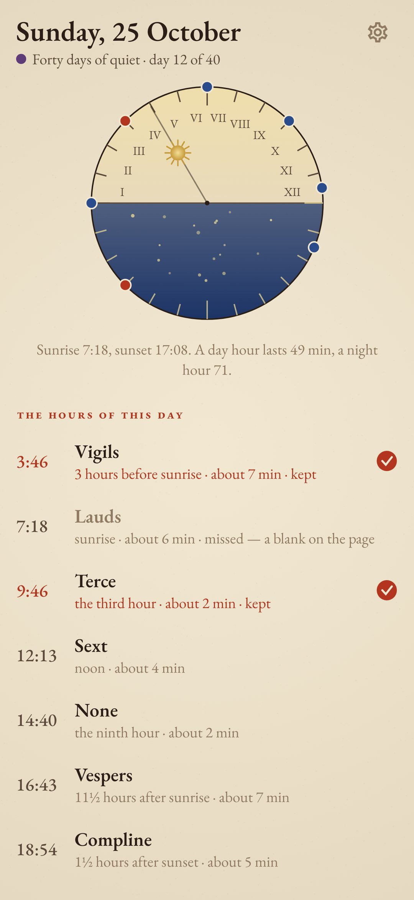
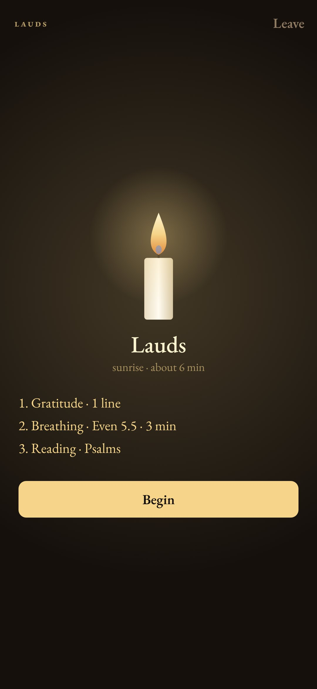
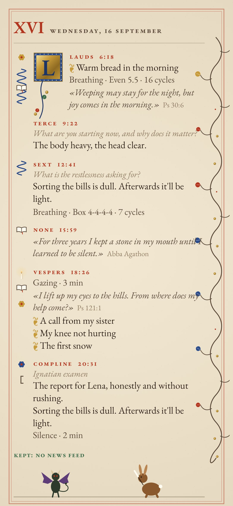
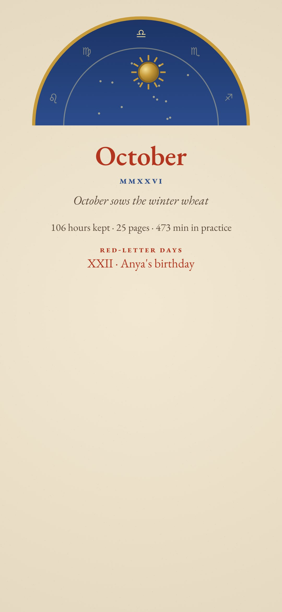
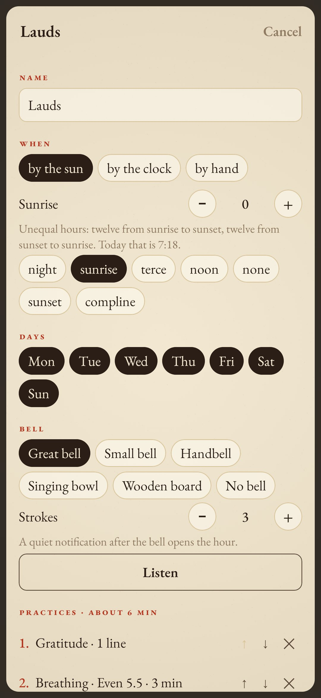

<div align="center">


# Horae

### A book of hours for your own practices.

*A medieval book of hours divided the day into hours of prayer, rung by a bell and counted by the sun. Horae keeps that frame and lets you fill it: how many hours, when they ring, and what each one holds (breathing, meditation, beads, a reading, a question, thanks, a review of the day, bows, a candle, silence or your own steps). Everything you keep is written into an illuminated manuscript. Free, no ads, no account, no internet.*

[](https://github.com/bigdevwhale/horae/actions/workflows/android.yml)


[](LICENSE)

**English** · [Русский](README.ru.md) · [Changelog](CHANGELOG.md)

    

</div>

---

## How it works

1. **Unequal hours.** As in the old reckoning, the light from sunrise to sunset is twelve hours and so is the dark, worked out offline from where you are. A summer day hour runs past eighty minutes, a winter one under fifty. The dial on the first screen shows the day's twelve and the night's twelve, your hours on its rim and the sun where it stands.
2. **Your rule.** Choose one to six or more hours. Each one is set by the sun (sunrise, the third hour, noon, sunset, an hour and a half after it), by the clock, or opened by hand. Pick its weekdays and its bell: a great bell, a small bell, a handbell, a singing bowl or a zen wooden board, rung its own number of strokes or the hour's number.
3. **Practices, one after another.** Every hour is a list you put together and reorder:
   - **breathing**: box, 4-7-8, even, long exhale, alternate nostril or your own, by minutes or cycles;
   - **meditation**: on the breath, a body scan, noting or open awareness, with interval bells;
   - **metta**: your own phrases round the circle of people;
   - **beads**: lestovka, mala, tasbih, rosary or plain, any count and marker, moved by a tap or the volume keys;
   - **reading**: psalms, Ecclesiastes, desert fathers, Thomas à Kempis, stoics, Tao, Dhammapada, zen, sufis or your own texts, with lectio divina;
   - **question**: your own, a rotation, or a bank (the noonday demon included);
   - **thanks**, **review of the day** (Ignatius, Seneca, Franklin or your steps), **bows**, **slow walking**, **gazing** (a candle or a window), **silence** (counted only while the phone lies face down), and **your own** steps with timers.
4. **The short rule.** Every hour can carry a one-minute version for a busy day or the road, so a minute counts instead of a blank.
5. **The manuscript.** A kept hour is written onto the day's page in rubrics and ink: the answer, the reading, the chosen word in red, the thanks. The marks of the practices sit in the margin. A vine grows along the edge, and the opening initial is red, then lapis, then burnished gold as more of the day's hours are kept. A missed hour leaves an empty space, with no reproach. Drolleries come to the margins: a snail, a hare scribe, a bird, a fish, a cat, and the noonday demon on the days noon was kept.
6. **The ink dries.** A past page can't be rewritten, only glossed in the margin, a note from the future in red.
7. **The calendar.** Each month opens with its leaf: the labour of the month, the zodiac arch with the sun where it really stands, and the month's count. Your own red-letter days are written in red; seasons of your own (forty days of something) colour the pages violet, green, white, red or rose. Day rules (no meat, no feeds) are ticked on the page.
8. **The great silence.** After the last hour of the day the book closes until the first bell tomorrow. A long press breaks the silence, and the page remembers it.
9. **The shelf.** On 31 December the year's book is bound in leather and goes on the shelf.
10. **Ready-made rules** to start from: Benedictine, Stoic, a zen day, Hesychast, a day of metta, five minutes with no religion, or a blank page.

## Build

```
./gradlew testDebugUnitTest assembleDebug
./gradlew -Pdemo assembleDebug          # app.horae.demo with six weeks of a Benedictine rule kept
./gradlew testDebugUnitTest -Prender --tests '*RenderArt*'   # every screen and the logo to app/build/art
python tools/shots.py app/build/art     # README screenshots from the renders
```

Everything is drawn in code: initials, vines, margin marks, drolleries, the dial and the candle in `ui/art/Illum.kt`. The bells are synthesised from bell partials in `sound/Sfx.kt`. The sun is the NOAA approximation in `domain/Sun.kt`. The readings (`app/src/main/assets/readings.tsv`) are our own renderings from public-domain originals; the questions are in `questions.tsv`.

Font: [EB Garamond](https://fonts.google.com/specimen/EB+Garamond), SIL Open Font License.

## Community

Bugs, ideas and updates go through the StillCraft bot on Telegram; the links are in the app's settings.

## License

MIT
