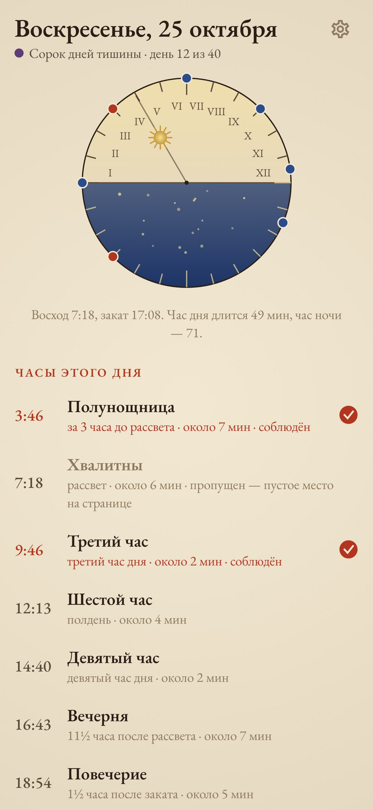
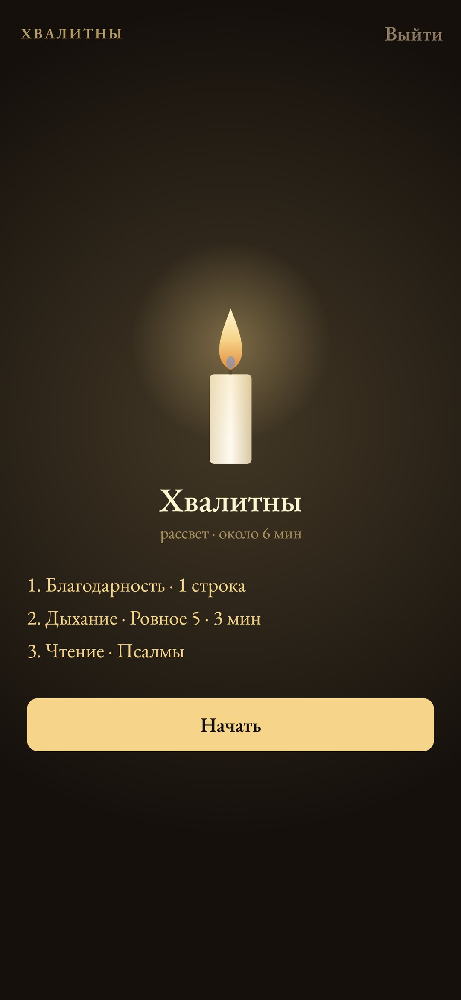
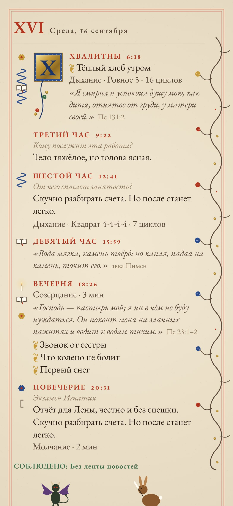
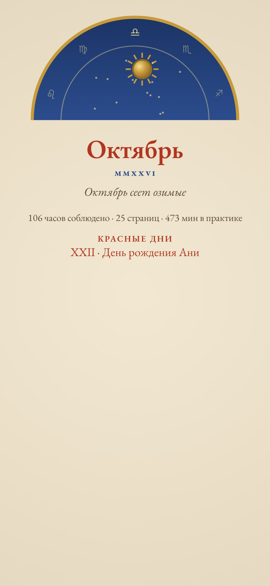
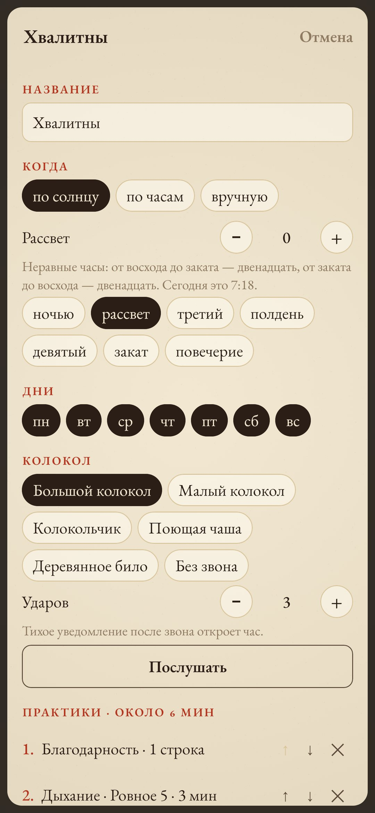

<div align="center">


# Часослов

### Книга часов для своих практик.

*Средневековый часослов делил день на часы молитвы: их звал колокол, а отсчитывало солнце. «Часослов» сохраняет эту раму и даёт наполнить её самому: сколько часов, когда они звонят и из чего состоит каждый. Дыхание, медитация, чётки, чтение, вопрос, благодарность, разбор дня, поклоны, свеча, молчание или свои шаги. Всё соблюдённое вписывается в иллюминированную рукопись. Бесплатно, без рекламы, без аккаунта и без интернета.*

[](https://github.com/bigdevwhale/horae/actions/workflows/android.yml)


[](LICENSE)

[English](README.md) · **Русский** · [Changelog](CHANGELOG.md)

    

</div>

---

## Как это устроено

1. **Неравные часы.** Как в старину: от восхода до заката двенадцать часов, от заката до восхода тоже двенадцать. Считается без сети, по тому месту, где ты находишься. Летом час дня длится больше восьмидесяти минут, зимой меньше пятидесяти. На циферблате первого экрана видны двенадцать часов дня и двенадцать ночи, твои часы по ободу и солнце там, где оно сейчас.
2. **Свой устав.** Часов может быть сколько угодно. Каждый ставится по солнцу (рассвет, третий час, полдень, закат, полтора часа после заката), по часам или открывается вручную. Для часа выбираются дни недели и колокол: большой, малый, колокольчик, поющая чаша или деревянное било, как в дзенском зале. Колокол бьёт заданное число ударов или номер часа.
3. **Практики одна за другой.** Каждый час — это список, который ты собираешь и переставляешь сам:
   - **дыхание**: квадрат, 4-7-8, ровное, долгий выдох, попеременное или своё; по минутам или по циклам;
   - **медитация**: на дыхании, сканирование тела, отмечание или открытое внимание; с промежуточными колоколами;
   - **метта**: свои фразы по кругу людей;
   - **чётки**: лестовка, мала, тасбих, розарий или простые; любое число бусин и разделителей; счёт касанием или кнопками громкости;
   - **чтение**: Псалмы, Екклесиаст, отцы пустыни, Фома Кемпийский, стоики, Дао, Дхаммапада, дзен, суфии или свои тексты; есть lectio divina;
   - **вопрос**: свой, список по очереди или из готового набора (есть и бес полуденный);
   - **благодарность**, **разбор дня** (Игнатий, Сенека, Франклин или свои шаги), **поклоны**, **медленная ходьба**, **созерцание** (свеча или окно), **молчание** (время идёт, только пока телефон лежит экраном вниз) и **свои** шаги с таймерами.
4. **Краткое правило.** У каждого часа может быть версия на одну минуту — для занятого дня или дороги. Тогда вместо пустого места засчитывается минута.
5. **Рукопись.** Соблюдённый час вписывается на страницу дня рубриками и чернилами: ответ, чтение, выбранное слово красным, благодарности. Следы практик остаются на полях. По краю растёт побег, а буквица становится красной, потом лазурной, потом золотой — чем больше часов дня соблюдено. Пропущенный час остаётся пустым местом, без упрёков. На поля приходят дролери: улитка, заяц-писец, птица, рыба, кот, а в дни, когда соблюдён полдень, — бес полуденный.
6. **Чернила высыхают.** Прошлую страницу нельзя переписать. Можно только оставить на полях глоссу — заметку из будущего красными чернилами.
7. **Календарь.** Каждый месяц открывается своим листом: труды месяца, арка зодиака с солнцем там, где оно стоит на самом деле, и итоги месяца. Свои красные дни пишутся красным. Свои сезоны (сорок дней чего-то) окрашивают страницы в фиолетовый, зелёный, белый, красный или розовый. Правила дня (без мяса, без ленты) отмечаются на странице.
8. **Великое молчание.** После последнего часа дня книга закрывается до первого колокола завтра. Молчание можно нарушить долгим нажатием, и страница это запомнит.
9. **Полка.** 31 декабря книга года переплетается в кожу и встаёт на полку.
10. **Готовые уставы** для начала: бенедиктинский, стоический, дзенский день, исихастский, день метты, «пять минут» без религии и чистый лист.

## Сборка

```
./gradlew testDebugUnitTest assembleDebug
./gradlew -Pdemo assembleDebug          # app.horae.demo: шесть недель бенедиктинского устава
./gradlew testDebugUnitTest -Prender --tests '*RenderArt*'   # все экраны и логотип в app/build/art
python tools/shots.py app/build/art     # скриншоты для README из рендеров
```

Всё нарисовано в коде: буквицы, побеги, следы на полях, дролери, циферблат и свеча — в `ui/art/Illum.kt`. Колокола синтезируются из обертонов в `sound/Sfx.kt`. Солнце считается по приближению NOAA в `domain/Sun.kt`. Тексты чтений (`app/src/main/assets/readings.tsv`) — собственные переводы из общественного достояния, вопросы лежат в `questions.tsv`.

Шрифт: [EB Garamond](https://fonts.google.com/specimen/EB+Garamond), SIL Open Font License.

## Сообщество

Баги, идеи и обновления — через бота StillCraft в Telegram. Ссылки есть в настройках приложения.

## Лицензия

MIT
